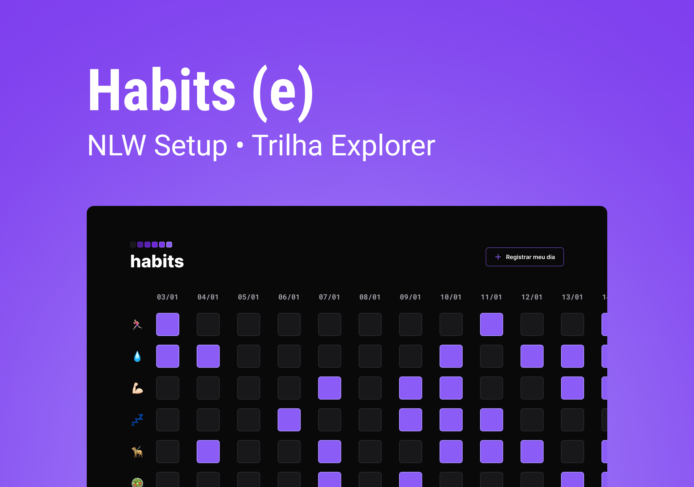

<h1 align="center"> Tracking habits </h1>

Utilizando tecnologias WEB está aplicação permite o rastreamento de hábitos.  

  <a href="#-tecnologias">Tecnologias</a>&nbsp;&nbsp;&nbsp;|&nbsp;&nbsp;&nbsp;
  <a href="#-projeto">Projeto</a>&nbsp;&nbsp;&nbsp;|&nbsp;&nbsp;&nbsp;
  <a href="#-layout">Layout</a>&nbsp;&nbsp;&nbsp; &nbsp;&nbsp;&nbsp;

 

  

## 🚀 Tecnologias

Esse projeto foi desenvolvido com as seguintes tecnologias:

- HTML e CSS
- JavaScript
- Git e Github
- Figma

## 💻 Projeto

O Habits é um app para ajudar a rastrear os hábitos.

- [Visite o projeto online](https://maykbrito.github.io/nlw-setup)

## 🔖 Layout

Você pode visualizar o layout do projeto através [DESSE LINK](https://www.figma.com/community/file/1195327109778210238). É necessário ter conta no [Figma](https://figma.com) para acessá-lo.

## 🧭 Desenvolvimento (Spec Driven)

Este projeto segue **Spec Driven Development** no formato do GitHub Spec Kit: toda feature começa por uma especificação aprovada.

- [Guia do processo](docs/sdd-guia.md)
- [Constituição do projeto](.specify/memory/constitution.md)
- [Especificações das features](specs/)

---